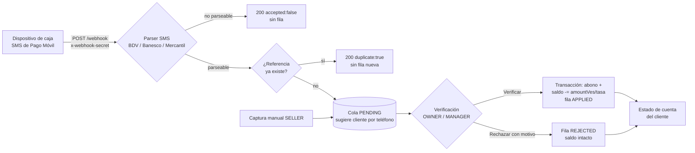

# Pagos entrantes de Pago Móvil — Webhook y verificación

> Módulo: `backend/src/modules/incoming-payments/` · Rutas: `/api/incoming-payments` ·
> Frontend: tab **Pagos por verificar** en la página de Clientes.

## Qué hace

El ERP recibe reclamos de Pago Móvil (Bs) desde la caja —por webhook o captura
manual— y los mantiene en una cola `PENDING` hasta que un responsable los
verifica o los rechaza. Solo al verificar se acredita el abono de CxC: se crea
un `CustomerPayment` (método `transfer`), se descuenta el saldo del cliente y
la fila queda `APPLIED`. Nunca se interpone dinero ni se cobra comisión.



## Configuración del secret del webhook

El endpoint público valida el header `x-webhook-secret` (o el campo `secret`
en el body) contra la variable de entorno:

```
PAYMENTS_WEBHOOK_SECRET=<cadena-larga-y-secreta>
```

**Producción: OBLIGATORIO.** El backend resuelve el secret con este orden
(`incoming-payments.routes.ts`):

1. `PAYMENTS_WEBHOOK_SECRET`
2. `JWT_SECRET` (fallback)
3. `dev-secret-change-in-production` (fallback final)

El riesgo del fallback es real y hay que decirlo sin rodeos: si no se configura
`PAYMENTS_WEBHOOK_SECRET`, el endpoint acepta el valor de `JWT_SECRET` — que en
varios entornos de esta casa termina siendo un valor conocido o por defecto.
Cualquier persona que adivine el secret puede inyectar reclamos falsos en la
cola. Eso **no** acredita saldo por sí solo (la verificación es manual y
auditada), pero sí puede colar un reclamo inventado ante un verificador
distraído. En cualquier entorno expuesto a Internet, definí siempre
`PAYMENTS_WEBHOOK_SECRET` con un valor aleatorio largo
(por ejemplo `openssl rand -hex 32`).

Nota: el secret se compara con `!==` simple, sin comparación constante en
tiempo. Es una superficie menor (header corto, endpoint público), pero tenlo en
cuenta si endurecés el módulo.

## Formato del payload

```json
{
  "sender": "2662",
  "body": "BDV: Ha recibido Pago Movil de 04141234567 por Bs 1.450,50 Ref 0987654321 el 07/10/2026",
  "received_at": "2026-10-14T15:30:00Z"
}
```

- `sender`: remitente del SMS (código corto del banco si existe).
- `body`: texto crudo del SMS. El parseo vive en el backend, no en el cliente.
- `received_at`: opcional; timestamp del dispositivo.

Ejemplo contra localhost (sin host real):

```bash
curl -X POST http://localhost:3000/api/incoming-payments/webhook \
  -H "Content-Type: application/json" \
  -H "x-webhook-secret: $PAYMENTS_WEBHOOK_SECRET" \
  -d '{
    "sender": "2662",
    "body": "BDV: Ha recibido Pago Movil de 04141234567 por Bs 1.450,50 Ref 0987654321 el 07/10/2026",
    "received_at": "2026-10-14T15:30:00Z"
  }'
```

Respuestas:

| Código | Cuerpo | Significado |
|--------|--------|-------------|
| 200 | `data.accepted: true, duplicate: false` | Reclamo creado (`PENDING`/`WEBHOOK`) |
| 200 | `data.accepted: true, duplicate: true` | Referencia ya existía; no se crea fila |
| 200 | `data.accepted: false, reason: "unparseable"` | SMS no reconocido; no se crea fila |
| 401 | `Invalid webhook secret` | Secret faltante o incorrecto |

El webhook responde **200** también cuando no parsea, a propósito: el
dispositivo emisor no debe entrar en loop de reintentos.

## Formatos de SMS soportados

El parser (`sms-parser.ts`) extrae monto en Bs, referencia y teléfono emisor.
Formatos aceptados, con ejemplos reales:

- **BDV** (códigos `2661` / `2662`):
  `BDV: Ha recibido Pago Movil de 04141234567 por Bs 1.450,50 Ref 0987654321 el 07/10/2026`
- **Banesco** (código `2846`), con cuenta enmascarada:
  `Banesco: Su cuenta 0134****1234 ha recibido un Pago Móvil de Bs 120.000,75 de 04161112233 Ref 99887766`
- **Mercantil** (código `24024`):
  `Mercantil: Recibiste Pago Movil por Bs 1.500,00 de 04241234567 Ref 123123`

Reglas generales: el monto debe llevar prefijo `Bs`, la referencia es un token
de 4 a 20 dígitos tras `Ref` / `Referencia`, y el teléfono emisor es un móvil
venezolano de 11 dígitos empezando por `04` (opcional). El banco se infiere del
código corto del remitente o, en su defecto, de una palabra clave del cuerpo.
Los montos se normalizan: `1.450,50`, `120.000,75`, `1450.50` y `1500` se
interpretan correctamente.

## Flujo de verificación en la UI

1. Entra la página **Clientes** → tab **Pagos por verificar**. El campana del
   TopBar muestra un badge con la cantidad de pendientes (se actualiza con el
   polling de notificaciones).
2. Cada fila de la cola muestra monto en Bs, referencia, banco emisor y, si el
   teléfono del SMS coincide con el de un cliente (`customer.phone` exacto o
   últimos 7 dígitos), el cliente sugerido.
3. **Verificar** acredita el abono: pide confirmación, convierte Bs → moneda
   base con la tasa vigente y descuenta el saldo. Si no hubo match de cliente,
   el selector exige elegir uno antes de verificar.
4. **Rechazar** pide un motivo; la fila queda `REJECTED` y el saldo no se toca.

Permisos (jerarquía `roleGuard`: OWNER > MANAGER > SELLER):

- Captura manual y ver la cola: SELLER+.
- Verificar / rechazar: **MANAGER y OWNER**. Un SELLER recibe 403.

## Limitaciones y notas de operación

- **Dedupe a nivel de aplicación**: la unicidad de `reference` se chequea con
  `findFirst` antes de crear la fila; no hay constraint `UNIQUE` en la base
  (el esquema de nube quedó intocado a propósito). Dos webhooks idénticos
  llegando exactamente a la vez podrían crear dos filas. En la práctica el
  emisor es un solo dispositivo secuencial; si algún día se paraleliza, agregar
  el unique en ambos schemas antes de escalar.
- **Teléfono receptor único = punto único de fallo**: la línea que recibe los
  SMS es una sola (el teléfono de la caja). Si el teléfono se apaga o pierde
  señal, no entran reclamos. **Mantener la captura manual como fallback**: el
  tab permite registrar el reclamo a mano con los mismos estados y verificación.
- **Tasa al momento de verificar**: `amountVes` se persiste en Bs; el
  `amountBase` (USD) se calcula al verificar con la tasa `VES` vigente
  (`exchangeRate` row). Se persisten `exchangeRate` y `amountBase` en la fila
  para auditoría. Si la tasa VES falta o es inválida, el backend cae a 3600 con
  un warning en logs — revisá esos warnings si aparecen. El verificador puede
  forzar una tasa distinta en el request de verificación.
- **Guardas idénticas a los abonos manuales**: cliente activo y
  `amountBase ≤ saldo` (sino 422 y la transacción completa se revierte). La
  verificación es idempotente: un segundo verify devuelve 409 y no duplica el
  abono (transición condicional `PENDING→APPLIED` con count-check).
- **El flujo manual de abonos no cambió**: `POST /api/customers/:id/payments`
  sigue acreditando al instante (cash/transfer/card). La verificación aplica
  solo a los reclamos entrantes.
- **Auditoría**: `PAYMENT_INCOMING_RECEIVED` (webhook audita con usuario nulo),
  `PAYMENT_VERIFIED` y `PAYMENT_REJECTED` quedan en el log de auditoría con
  actor e IP.
- **Integración conocida con el listener APK (T4)**: el APK de ALL MARKET
  (futuro listener de SMS en el teléfono de caja) debe enviar el SMS crudo al
  webhook con el header `x-webhook-secret`; el parseo y la cola viven en el
  backend. Ese componente está fuera del alcance v1: hoy el endpoint y la
  captura manual están listos para recibirlo.
